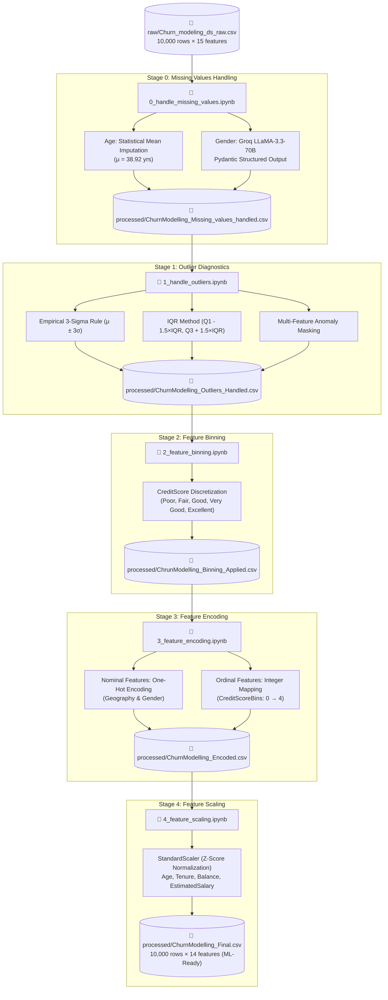

# 📊 Customer Churn Prediction – End-to-End Data Preprocessing & Feature Engineering Pipeline

[](https://www.python.org/)
[](https://docs.google.com/document/d/1MuRwKGO-OJ43h3LkXdOzkeO66sPQiS12/edit?usp=drive_link&ouid=118394684805096545720&rtpof=true&sd=true)
[](https://groq.com/)
[](https://pandas.pydata.org/)
[](https://scikit-learn.org/)
[](https://docs.pydantic.dev/)
[](https://opensource.org/licenses/MIT)
[](CONTRIBUTING.md)

An end-to-end, production-grade **data preprocessing and feature engineering pipeline** for bank customer churn prediction. This project bridges classical statistical data preparation techniques with modern **Generative AI (Groq + LLaMA 3.3 70B)** to transform raw, noisy customer data into a robust, model-ready machine learning dataset.

> [!NOTE]
> 📄 **Article Link:** Read the complete detailed article and documentation here:  
> 👉 **[Customer Churn Prediction Article (Google Docs)](https://docs.google.com/document/d/1MuRwKGO-OJ43h3LkXdOzkeO66sPQiS12/edit?usp=drive_link&ouid=118394684805096545720&rtpof=true&sd=true)**

---

## 📑 Table of Contents

- [Article Link](#-article-link)
- [Overview](#-overview)
- [Pipeline Architecture](#-pipeline-architecture)
- [Key Innovations](#-key-innovations)
- [Deep Dive: Step-by-Step Notebooks](#-deep-dive-step-by-step-notebooks)
  - [0. Missing Values Handling & LLM Imputation](#0-missing-values-handling--llm-imputation)
  - [1. Outlier Diagnostics & Analysis](#1-outlier-diagnostics--analysis)
  - [2. Domain-Specific Feature Binning](#2-domain-specific-feature-binning)
  - [3. Categorical Feature Encoding](#3-categorical-feature-encoding)
  - [4. Feature Scaling & Final ML Matrix](#4-feature-scaling--final-ml-matrix)
- [Data Lineage & Artifact Traceability](#-data-lineage--artifact-traceability)
- [Dataset Dictionary & Schema Evolution](#-dataset-dictionary--schema-evolution)
- [Folder Structure](#-folder-structure)
- [Quickstart & Installation](#-quickstart--installation)
- [Environment Configuration](#-environment-configuration)
- [Running the Pipeline](#-running-the-pipeline)
- [Tech Stack](#-tech-stack)
- [Roadmap & Upcoming Modules](#-roadmap--upcoming-modules)
- [Contributing](#-contributing)
- [License & Acknowledgments](#-license--acknowledgments)

---

## 📄 Article Link

The complete research walkthrough, business context, and in-depth methodology are documented in the companion article:

🔗 **[Read the Full Article on Google Docs](https://docs.google.com/document/d/1MuRwKGO-OJ43h3LkXdOzkeO66sPQiS12/edit?usp=drive_link&ouid=118394684805096545720&rtpof=true&sd=true)**

---

## 💡 Overview

In real-world data science, **over 80% of project time is spent cleaning, verifying, and transforming raw data**. Suboptimal handling of missing values, uncalibrated outliers, naive categorical encoding, or improper feature scaling can silently degrade machine learning performance, introduce target leakage, and lead to poor generalization.

This repository demonstrates how to execute each stage of the data preprocessing lifecycle with mathematical rigor, practical domain heuristics (banking and credit risk), and state-of-the-art LLM-powered structured imputation.

```
Raw Bank Data (10,000 × 15)  ───►  Cleaned & Engineered Matrix (10,000 × 14)
   - Missing Age & Gender               - GenAI Imputed Categoricals
   - Uncalibrated Outliers              - Parametric & IQR Diagnostics
   - Raw Continuous Scores              - FICO Risk Tier Binning
   - Mixed Categorical Types            - One-Hot + Monotonic Ordinal Encoding
   - Disparate Value Scales             - Standardized (Z-Score) Normalization
```

---

## 🏛 Pipeline Architecture

The data flows through five sequential, checkpointed stages:



---

## ⚡ Key Innovations

- 🧠 **Zero-Shot LLM Demographics Imputation**: Instead of discarding records with missing `Gender` or filling with simple mode (which distorts distribution), the pipeline uses `groq` with `llama-3.3-70b-versatile` and `pydantic` validation to predict customer gender from first and last names with high contextual accuracy.
- 📐 **Dual Outlier Detection Protocols**: Implements both parametric (Gaussian 3-Sigma) and non-parametric (Tukey's IQR) fences with multi-attribute anomaly masking to identify critical edge cases without blindly destroying legitimate high-net-worth customer records.
- 🏦 **Domain-Aligned Financial Binning**: Transforms raw continuous `CreditScore` into standardized FICO scoring categories (`Poor`, `Fair`, `Good`, `Very Good`, `Excellent`), reducing continuous variance noise and capturing non-linear churn inflection points.
- 🔄 **Hybrid Encoding Strategy**: Combines dummy variable generation (`pd.get_dummies` / `OneHotEncoder`) for unordered categories with monotonic integer rank mapping for ordinal tiers.
- 💾 **Granular Artifact Checkpointing**: Every notebook reads from the preceding artifact and exports its own output CSV inside `processed/`, ensuring full reproducibility, traceability, and intermediate validation.

---

## 🔬 Deep Dive: Step-by-Step Notebooks

### 0. Missing Values Handling & LLM Imputation
**File:** [`0_handle_missing_values.ipynb`](churn-prediction-data-pipeline-main/0_handle_missing_values.ipynb)  
**Input:** `raw/Churn_modeling_ds_raw.csv` | **Output:** `processed/ChurnModelling_Missing_values_handled.csv`

- **Missing Data Audit:**
  - `Age`: 600 missing values (~6% missingness)
  - `Gender`: 108 missing values (~1.08% missingness)
  - `Firstname`: 7 missing values | `Lastname`: 6 missing values
- **Numerical Imputation (`Age`):**
  - Calculated mean $\mu = 38.92$ and median $= 37.0$.
  - Filled missing `Age` with statistical mean, preserving overall demographic central tendency.
- **LLM-Powered Categorical Imputation (`Gender`):**
  - Employs Groq API hosting `llama-3.3-70b-versatile`.
  - Enforces schema validation using `Pydantic` `BaseModel` and `Enum`:
    ```python
    class Gender(str, Enum):
        MALE = 'Male'
        FEMALE = 'Female'

    class GenderPrediction(BaseModel):
        firstname: str
        lastname: str
        pred_gender: Gender
    ```
  - Prompts the LLM with customer name tokens to infer the most probable gender, guaranteeing zero nulls without manual labeling.

---

### 1. Outlier Diagnostics & Analysis
**File:** [`1_handle_outliers.ipynb`](churn-prediction-data-pipeline-main/1_handle_outliers.ipynb)  
**Input:** `processed/ChurnModelling_Missing_values_handled.csv` | **Output:** `processed/ChurnModelling_Outliers_Handled.csv`

- **Evaluated Numerical Features:** `CreditScore`, `Age`, `Tenure`, `Balance`, `EstimatedSalary`.
- **Diagnostic Methodologies:**
  1. **Empirical 3-Sigma Rule (Parametric):**
     $$\text{Bounds} = \mu \pm 3\sigma$$
  2. **Interquartile Range (IQR Rule, Non-Parametric):**
     $$\text{IQR} = Q_3 - Q_1$$
     $$\text{Lower Fence} = Q_1 - 1.5 \times \text{IQR}, \quad \text{Upper Fence} = Q_3 + 1.5 \times \text{IQR}$$
- **Multi-Feature Anomaly Masking:**
  - Builds a comprehensive boolean anomaly matrix across all features.
  - Computes row-wise anomaly counts to flag multivariate outliers (e.g., customers exhibiting simultaneous anomalies across multiple attributes).
  - Preserves valid high-net-worth customer balances while ensuring clean boundaries for downstream estimators.

---

### 2. Domain-Specific Feature Binning
**File:** [`2_feature_binning.ipynb`](churn-prediction-data-pipeline-main/2_feature_binning.ipynb)  
**Input:** `processed/ChurnModelling_Outliers_Handled.csv` | **Output:** `processed/ChrunModelling_Binning_Applied.csv`

- **Motivation:** Raw continuous credit scores often correlate non-linearly with customer attrition. Discretizing credit score into financial credit rating bands stabilizes model weights.
- **Binning Scheme (FICO Industry Standards):**
  | Credit Score Range | Risk Category | Bin Label |
  |:-------------------|:--------------|:----------|
  | `< 580`            | Very High Risk| `Poor` |
  | `580 - 669`        | Moderate Risk | `Fair` |
  | `670 - 739`        | Good Standing | `Good` |
  | `740 - 799`        | Low Risk      | `Very Good` |
  | `800 - 850`        | Prime Tier    | `Excellent` |
- Original continuous `CreditScore` is replaced with `CreditScoreBins`.

---

### 3. Categorical Feature Encoding
**File:** [`3_feature_encoding.ipynb`](churn-prediction-data-pipeline-main/3_feature_encoding.ipynb)  
**Input:** `processed/ChrunModelling_Binning_Applied.csv` | **Output:** `processed/ChurnModelling_Encoded.csv`

- **Nominal Variables (Unordered):**
  - Features: `Geography` (`France`, `Germany`, `Spain`) and `Gender` (`Female`, `Male`).
  - Strategy: **One-Hot Encoding** using `pd.get_dummies()` and `sklearn.preprocessing.OneHotEncoder`.
  - Creates explicit binary columns: `Geography_France`, `Geography_Germany`, `Geography_Spain`, `Gender_Female`, `Gender_Male`.
- **Ordinal Variables (Ordered):**
  - Feature: `CreditScoreBins`.
  - Strategy: **Monotonic Integer Rank Mapping** to preserve natural hierarchy:
    ```python
    encode_dict_creditscore = {
        'Poor': 0,
        'Fair': 1,
        'Good': 2,
        'Very Good': 3,
        'Excellent': 4
    }
    ```

---

### 4. Feature Scaling & Final ML Matrix
**File:** [`4_feature_scaling.ipynb`](churn-prediction-data-pipeline-main/4_feature_scaling.ipynb)  
**Input:** `processed/ChurnModelling_Encoded.csv` | **Output:** `processed/ChurnModelling_Final.csv`

- **Theoretical Analysis:**
  - **Normalization (Min-Max Scaling):** Rescales to $[0, 1]$:
    $$X_{\text{norm}} = \frac{X - X_{\min}}{X_{\max} - X_{\min}}$$
  - **Standardization (Z-Score Scaling):** Centers mean at $0$ with unit variance $\sigma = 1$:
    $$Z = \frac{X - \mu}{\sigma}$$
- **Implementation:**
  - Features scaled: `Age`, `Tenure`, `Balance`, `EstimatedSalary`.
  - Employs `StandardScaler` to maintain robustness against distribution tails and ensure optimal gradient descent convergence for linear/logistic models, neural networks, and distance-based classifiers (KNN, SVM).
- **Result:** Fully sanitized, encoded, and scaled numeric matrix ready for immediate model training.

---

## 📈 Data Lineage & Artifact Traceability

| Step | Notebook | Input Artifact | Operations Performed | Output Artifact | Dimensions |
|:---:|:---|:---|:---|:---|:---:|
| **0** | `0_handle_missing_values.ipynb` | `raw/Churn_modeling_ds_raw.csv` | Mean imputation on `Age`, Groq LLaMA-3.3-70B on `Gender`, Dropped metadata IDs | `processed/ChurnModelling_Missing_values_handled.csv` | 10,000 × 11 |
| **1** | `1_handle_outliers.ipynb` | `processed/ChurnModelling_Missing_values_handled.csv` | 3-Sigma & IQR calculation, multi-anomaly logging & verification | `processed/ChurnModelling_Outliers_Handled.csv` | 10,000 × 11 |
| **2** | `2_feature_binning.ipynb` | `processed/ChurnModelling_Outliers_Handled.csv` | Custom FICO risk tier discretization on `CreditScore` | `processed/ChrunModelling_Binning_Applied.csv` | 10,000 × 11 |
| **3** | `3_feature_encoding.ipynb` | `processed/ChrunModelling_Binning_Applied.csv` | One-Hot Encoding (`Geography`, `Gender`) + Ordinal mapping (`CreditScoreBins`) | `processed/ChurnModelling_Encoded.csv` | 10,000 × 14 |
| **4** | `4_feature_scaling.ipynb` | `processed/ChurnModelling_Encoded.csv` | `StandardScaler` on continuous features (`Age`, `Tenure`, `Balance`, `Salary`) | `processed/ChurnModelling_Final.csv` | **10,000 × 14** |

---

## 📋 Dataset Dictionary & Schema Evolution

### Raw vs. Final Feature Matrix

| Feature Name | Raw Data Type | Final Data Type | Transformation Details | Description |
|:---|:---:|:---:|:---|:---|
| `RowNumber` | `int64` | *Dropped* | Excluded (non-predictive metadata) | Row index identifier |
| `CustomerId` | `int64` | *Dropped* | Excluded (prevents ID memorization) | Unique bank customer identifier |
| `Firstname` | `object` | *Dropped* | Used only for Groq LLM gender inference | Customer first name |
| `Lastname` | `object` | *Dropped* | Used only for Groq LLM gender inference | Customer surname |
| `CreditScore` | `int64` | `int64` | Binned into `CreditScoreBins` & ordinally encoded (`0-4`) | FICO credit score rating |
| `Geography` | `object` | `uint8` | One-hot encoded into 3 dummy indicators | Country of residence (`France`, `Germany`, `Spain`) |
| `Gender` | `object` | `uint8` | Imputed via LLM, then one-hot encoded into 2 dummy indicators | Customer gender (`Female`, `Male`) |
| `Age` | `float64` | `float64` | Missing values imputed with mean ($\mu = 38.92$), then Z-score standardized | Customer age in years |
| `Tenure` | `int64` | `float64` | Z-score standardized ($\mu = 5.01, \sigma = 2.89$) | Number of years as bank customer |
| `Balance` | `float64` | `float64` | Z-score standardized ($\mu = 76,485.89, \sigma = 62,397.41$) | Account bank balance |
| `NumOfProducts` | `int64` | `int64` | Retained as discrete numeric feature | Number of bank products purchased |
| `HasCrCard` | `int64` | `int64` | Retained as binary flag (`0 = No`, `1 = Yes`) | Credit card ownership status |
| `IsActiveMember` | `int64` | `int64` | Retained as binary flag (`0 = Inactive`, `1 = Active`) | Bank activity engagement index |
| `EstimatedSalary`| `float64` | `float64` | Z-score standardized ($\mu = 100,090.24, \sigma = 57,510.49$) | Estimated annual customer income |
| **`Exited`** | `int64` | `int64` | **Target Variable** (`0 = Retained`, `1 = Churned`) | Customer churn outcome |

---

## 📂 Folder Structure

```plaintext
pa_article-/
│
├── 📂 raw/
│   └── Churn_modeling_ds_raw.csv                # Raw, uncleaned dataset (10,000 rows x 15 cols)
│
├── 📂 processed/
│   ├── ChurnModelling_Missing_values_handled.csv # Checkpoint 0: Imputed Age & Gender (10,000 x 11)
│   ├── ChurnModelling_Outliers_Handled.csv       # Checkpoint 1: Outlier audited dataset (10,000 x 11)
│   ├── ChrunModelling_Binning_Applied.csv        # Checkpoint 2: Discretized CreditScore (10,000 x 11)
│   ├── ChurnModelling_Encoded.csv                # Checkpoint 3: One-Hot & Ordinal encoded (10,000 x 14)
│   └── ChurnModelling_Final.csv                  # Checkpoint 4: Standardized ML-ready matrix (10,000 x 14)
│
├── 📓 0_handle_missing_values.ipynb              # Notebook 0: Central tendency & GenAI imputation
├── 📓 1_handle_outliers.ipynb                    # Notebook 1: 3-Sigma & IQR outlier diagnostics
├── 📓 2_feature_binning.ipynb                    # Notebook 2: FICO score binning logic
├── 📓 3_feature_encoding.ipynb                   # Notebook 3: One-Hot and Ordinal encoding
├── 📓 4_feature_scaling.ipynb                    # Notebook 4: Normalization vs Standardization
│
├── 📄 .env.example                               # Environment template for Groq API Key
├── 📄 .gitignore                                 # Git ignore patterns
├── 📄 CONTRIBUTING.md                            # Contribution guidelines and community standards
├── 📄 requirements.txt                           # Project dependencies
└── 📄 README.md                                  # Complete project documentation
```

---

## 🚀 Quickstart & Installation

### 1. Prerequisites
- **Python 3.9+** installed on your system.
- A free **[Groq Cloud API Key](https://console.groq.com/)** for LLM-assisted missing value imputation.

### 2. Clone the Repository
```bash
git clone https://github.com/nitinpoonia0504-glitch/pa_article-.git
cd pa_article-
```

### 3. Set Up a Virtual Environment

**On Windows (PowerShell):**
```powershell
python -m venv venv
.\venv\Scripts\Activate.ps1
```

**On macOS / Linux:**
```bash
python3 -m venv venv
source venv/bin/activate
```

### 4. Install Dependencies
```bash
pip install --upgrade pip
pip install -r requirements.txt
```

---

## 🔑 Environment Configuration

Create a local `.env` file from `.env.example` in the project root:

```bash
cp .env.example .env
```

Open `.env` and add your Groq API key:
```env
GROQ_API_KEY=gsk_your_actual_groq_api_key_here
```

> [!TIP]
> Never commit your `.env` file with secret keys to version control. The `.env` file is already listed in `.gitignore`.

---

## 🏃 Running the Pipeline

You can run the notebooks interactively via **JupyterLab**, **Jupyter Notebook**, or **VS Code**:

```bash
# Launch JupyterLab
jupyter lab
```

Or step-by-step through any Jupyter-compatible IDE:

1. **Step 0:** Open and run [`0_handle_missing_values.ipynb`](churn-prediction-data-pipeline-main/0_handle_missing_values.ipynb) to inspect raw data, compute statistical imputation, and trigger Groq LLM demographic filling.
2. **Step 1:** Open and run [`1_handle_outliers.ipynb`](churn-prediction-data-pipeline-main/1_handle_outliers.ipynb) to visualize distribution plots, box plots, and evaluate outlier boundaries.
3. **Step 2:** Open and run [`2_feature_binning.ipynb`](churn-prediction-data-pipeline-main/2_feature_binning.ipynb) to discretize credit scores into domain risk buckets.
4. **Step 3:** Open and run [`3_feature_encoding.ipynb`](churn-prediction-data-pipeline-main/3_feature_encoding.ipynb) to generate dummy variables and ordinal mappings.
5. **Step 4:** Open and run [`4_feature_scaling.ipynb`](churn-prediction-data-pipeline-main/4_feature_scaling.ipynb) to generate `processed/ChurnModelling_Final.csv`.

---

## 🛠 Tech Stack

| Domain | Tool / Library | Purpose |
|:---|:---|:---|
| **Language** | Python 3.9+ | Core programming language |
| **Data Manipulation** | `pandas` (v2.1+), `numpy` (v1.26+) | High-performance tabular data structures and vectorization |
| **Generative AI** | `groq`, `llama-3.3-70b-versatile` | Ultra-fast inference for zero-shot demographic missing value imputation |
| **Data Validation** | `pydantic` (v2+) | Strict typing and structured output validation from LLM responses |
| **Machine Learning** | `scikit-learn` (v1.3+) | Data scaling (`StandardScaler`, `MinMaxScaler`) and encoders |
| **Data Visualization** | `seaborn`, `matplotlib` | Statistical distribution plotting, histograms, and box plots |
| **Configuration** | `python-dotenv` | Secure API key and environment variable management |

---

## 🔮 Roadmap & Upcoming Modules

- [x] **Phase 1: Comprehensive Data Preprocessing Pipeline** (Completed)
  - [x] Missing value imputation with classical stats + Groq LLM
  - [x] Outlier detection via 3-Sigma and IQR
  - [x] Financial credit rating binning
  - [x] Dual nominal & ordinal encoding
  - [x] Feature scaling and final ML tensor generation
- [ ] **Phase 2: Exploratory Data Analysis & Feature Importance**
  - [ ] Correlation matrix and Multicollinearity (VIF) analysis
  - [ ] Target balance evaluation (SMOTE / Class Weighting strategies)
- [ ] **Phase 3: Supervised Model Benchmarking**
  - [ ] Baseline models: Logistic Regression, Random Forest, XGBoost, LightGBM, CatBoost
  - [ ] Hyperparameter tuning with Optuna / GridSearchCV
  - [ ] Evaluation metrics: ROC-AUC, PR-AUC, F1-Score, Confusion Matrix
- [ ] **Phase 4: Interpretability & Deployment**
  - [ ] SHAP (SHapley Additive exPlanations) & LIME model interpretability
  - [ ] Interactive Streamlit churn prediction dashboard
  - [ ] FastAPI serving endpoint with Docker containerization

---

## 🤝 Contributing

Contributions, issues, and feature suggestions are highly welcomed!

1. Fork the Project (`gh repo fork nitinpoonia0504-glitch/pa_article-`)
2. Create your Feature Branch (`git checkout -b feature/AmazingPreprocessingFeature`)
3. Commit your Changes (`git commit -m 'Add some AmazingFeature'`)
4. Push to the Branch (`git push origin feature/AmazingPreprocessingFeature`)
5. Open a Pull Request

Please review our [Contributing Guidelines](CONTRIBUTING.md) before submitting code.

---

## 📄 License & Acknowledgments

This project is licensed under the **MIT License** — feel free to use, modify, and distribute for educational or commercial purposes.

- Dataset source: Bank Customer Churn Modeling Benchmark Dataset.
- Special thanks to the open-source community for **Groq**, **Meta LLaMA**, and **Scikit-Learn**.

---

<p align="center">
  Crafted with ❤️ by <a href="https://github.com/nitinpoonia0504-glitch"><b>Nitin Poonia</b></a>
</p>
<p align="center">
  <i>If you found this pipeline useful for your machine learning journey, please consider starring ⭐ the repository!</i>
</p>
